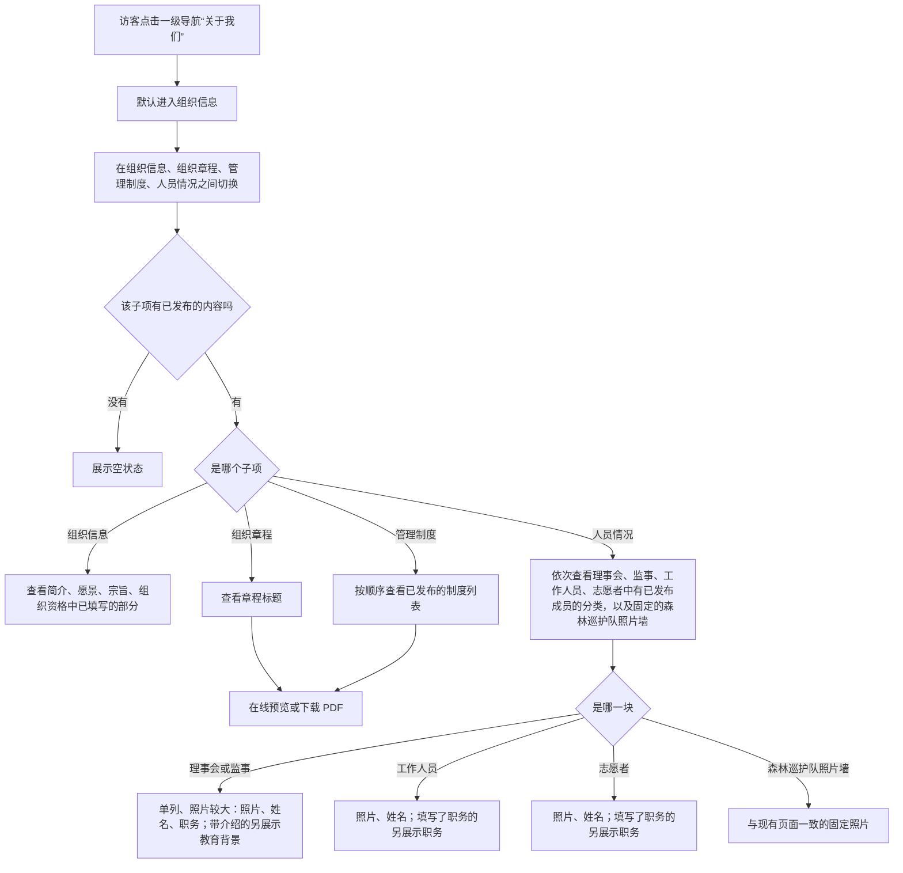
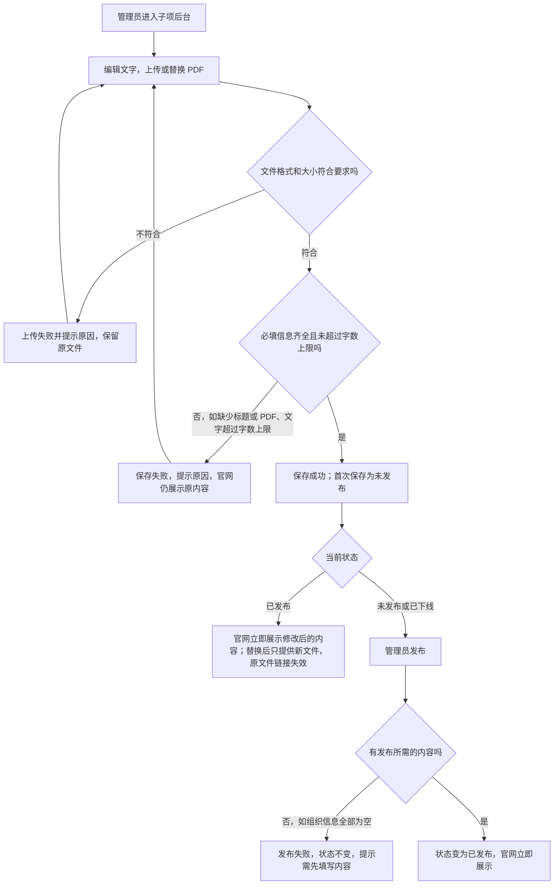
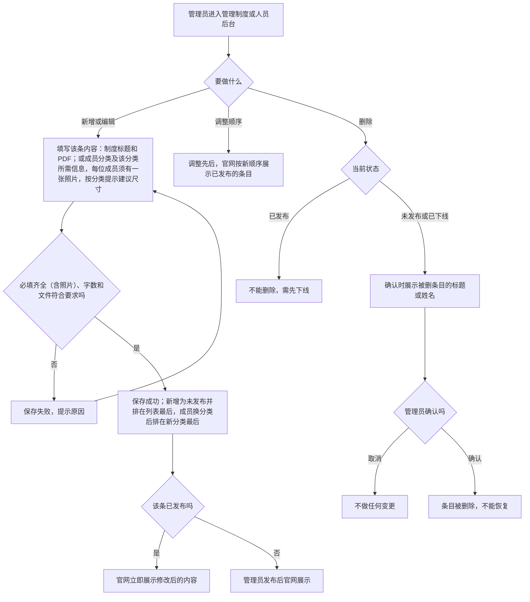
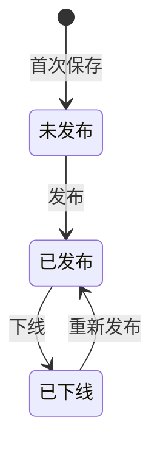
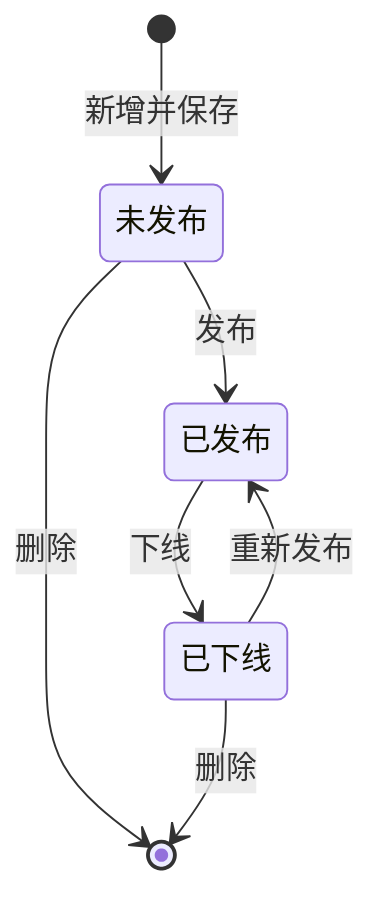

# 关于我们 · 流程图与状态机

2026-11-03｜需求评审稿

本册把功能册中的主要流程与状态画成图，规则以 [01 功能与业务规则](luna-about-us-prd-01-functions.md) 为准。图中方框是业务环节，不代表页面或组件。

| 图 | 内容 | 对应功能 |
| --- | --- | --- |
| 图 1 | 官网访客进入关于我们、切换子项，查看组织信息、章程、制度列表和人员情况 | [关于我们栏目结构（ABOUT-00）](luna-about-us-prd-01-functions.md#ABOUT-00) |
| 图 2 | 管理员维护组织信息、组织章程这类单份内容，并发布到官网 | [后台维护通用规则（ABOUT-05）](luna-about-us-prd-01-functions.md#ABOUT-05)、[组织信息（ABOUT-01）](luna-about-us-prd-01-functions.md#ABOUT-01)、[组织章程（ABOUT-02）](luna-about-us-prd-01-functions.md#ABOUT-02) |
| 图 3 | 管理员新增、编辑、发布、下线、删除列表内容（管理制度、人员）及调整顺序 | [管理制度（ABOUT-03）](luna-about-us-prd-01-functions.md#ABOUT-03)、[人员情况（ABOUT-04）](luna-about-us-prd-01-functions.md#ABOUT-04) |
| 图 4 | 单份内容的发布状态：未发布、已发布、已下线，不能删除 | [发布与下线](luna-about-us-prd-01-functions.md#ABOUT-05-STATUS) |
| 图 5 | 列表内容的发布状态：未发布、已发布、已下线，未发布和已下线可删除 | [发布与下线](luna-about-us-prd-01-functions.md#ABOUT-05-STATUS)、[列表内容的新增、排序与删除](luna-about-us-prd-01-functions.md#ABOUT-05-DELETE) |

## 图 1 官网访客浏览关于我们

## 图 2 管理员维护并发布单份内容

适用于组织信息、组织章程。

## 图 3 管理员维护列表内容

适用于管理制度、人员。森林巡护队照片墙内容固定，不在后台维护。

## 图 4 单份内容发布状态机

适用于组织信息、组织章程。

- 初始状态：从未保存过时没有状态，后台显示为未填写；首次保存后为未发布。
- 单份内容没有终态，不能删除。
- 任何状态下编辑保存都不改变状态；已发布时保存后官网立即展示修改后的内容。
- 发布失败时状态不变。

## 图 5 列表内容发布状态机

适用于每份管理制度、每位成员。

- 初始状态：未发布。
- 已发布不能直接删除，须先下线。
- 任何状态下编辑保存（包括修改成员的所属分类）都不改变状态。
- 删除后不能恢复。
