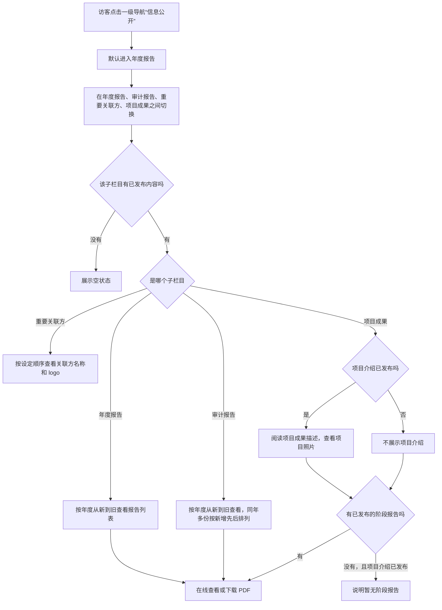
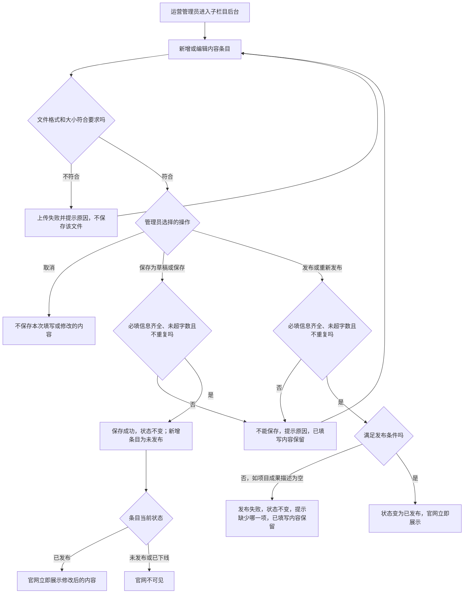
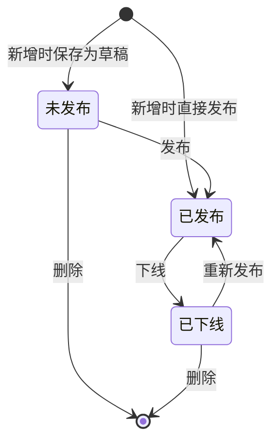
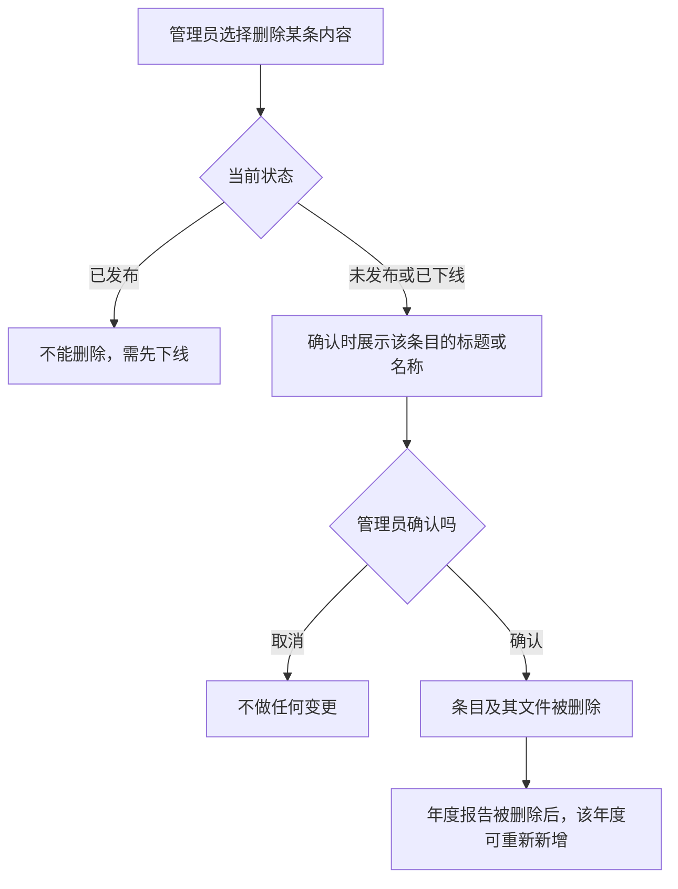

# 信息公开 · 流程图与状态机

2026-10-22｜需求评审稿

本册把功能册中的主要流程与状态画成图，规则以 [01 功能与业务规则](luna-info-disclosure-prd-01-functions.md) 为准。图中方框是业务环节，不代表页面或组件。

| 图 | 内容 | 对应功能 |
| --- | --- | --- |
| 图 1 | 官网访客从导航进入信息公开、切换子栏目并查看或下载内容 | [信息公开栏目入口（XXGK-00）](luna-info-disclosure-prd-01-functions.md#XXGK-00) |
| 图 2 | 管理员新增或编辑内容条目，保存为草稿或直接发布到官网 | [新增和编辑时的保存方式](luna-info-disclosure-prd-01-functions.md#XXGK-ADM-SAVE) |
| 图 3 | 内容条目的发布状态：未发布、已发布、已下线 | [发布与下线](luna-info-disclosure-prd-01-functions.md#XXGK-ADM-STATUS) |
| 图 4 | 删除内容条目 | [删除](luna-info-disclosure-prd-01-functions.md#XXGK-ADM-DELETE) |

## 图 1 官网访客浏览信息公开

项目成果中项目介绍未发布且没有已发布阶段报告时，子栏目没有已发布内容，按上图“展示空状态”处理。

## 图 2 管理员维护并发布内容

已发布条目编辑时只有“保存”和“取消”，保存后官网立即更新。各状态下可选的操作见 [新增和编辑时的保存方式](luna-info-disclosure-prd-01-functions.md#XXGK-ADM-SAVE)。

## 图 3 内容条目发布状态机

适用于年度报告、审计报告、关联方、项目介绍、阶段报告。项目介绍与阶段报告各自发布、互不影响，两者叠加时的官网展示见 [项目成果（XXGK-04）](luna-info-disclosure-prd-01-functions.md#XXGK-04)。

- 新增条目的初始状态取决于新增时的操作：保存为草稿为未发布，直接发布为已发布。项目介绍始终存在，初始状态为未发布。
- 已发布不能直接删除，须先下线。
- 项目介绍不能删除，只能下线。
- 保存为草稿和保存都不改变状态。
- 只有已发布的条目，其文件可被官网访客访问；下线或删除后，原文件链接不再可访问，规则见 [文件上传](luna-info-disclosure-prd-01-functions.md#XXGK-ADM-FILE)。
- 删除后条目不复存在，不能恢复。

## 图 4 删除内容条目

项目介绍不能删除，不出现在本流程中。
